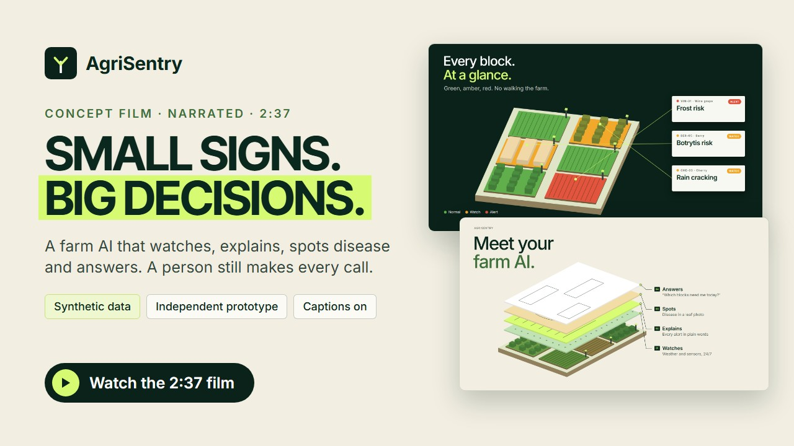
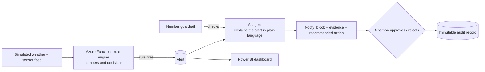

# AgriSentry

[](README.md) [](README.zh-CN.md)

**🌐 Live site → [zeeekrom.github.io/agrisentry](https://zeeekrom.github.io/agrisentry/)** · [interactive 3D farm view ↗](https://zeeekrom.github.io/agrisentry/3d.html) · [concept film ↗](https://zeeekrom.github.io/agrisentry/film/)

> A configurable farm-monitoring system on the Microsoft Power Platform, built around a **constrained farm AI agent**. It turns (simulated) weather and sensor data into **per-crop risk alerts a person approves** before any action — the agent watches, explains each alert in plain language, and answers, while every number comes from a deterministic rule engine and a person makes every call. With an immutable audit trail and a Power BI dashboard.


<a href="https://zeeekrom.github.io/agrisentry/film/"></a>

**Concept film:** [watch the 2:37 narrated film](https://zeeekrom.github.io/agrisentry/film/) — what a small farm is missing today, a farm AI that watches, explains, spots disease and answers questions, and the person who still makes every call. English narration (synthetic voice) with captions; synthetic data.

**This is a curated, privacy-safe showcase.** The application source, configuration, solution files and data pipelines live in a private repository. This public edition holds the write-up, high-level diagrams and synthetic screenshots only — **no source code and no real data**. Source is available for review on request.

This is an independent portfolio prototype. It is **not affiliated with any real farm or organisation**, uses only synthetic data, and performs no real-world actions.

## Contents

- [At a glance](#at-a-glance)
- [The problem](#the-problem)
- [Who it is for](#who-it-is-for)
- [One alert, start to finish](#one-alert-start-to-finish)
- [The AI agent](#the-ai-agent)
- [Design principles](#design-principles)
- [Configurable by design](#configurable-by-design)
- [The dashboard](#the-dashboard)
- [How it was built](#how-it-was-built)
- [Technology](#technology)
- [Synthetic data](#synthetic-data)
- [What is not finished](#what-is-not-finished)
- [What the project shows](#what-the-project-shows)
- [Status, source &amp; terms](#status-source--terms)

## Overview


## At a glance

| | |
|---|---|
| What it is | A configurable farm-monitoring workflow: per-crop risk rules, a grounded AI agent, human-approved alerts, a tamper-evident record and a dashboard |
| Who it is for | Small / mid farms and the people who run them — managers, field workers, owners |
| The problem | Farm data is scattered across paper and spreadsheets; high-risk events (e.g. frost) are caught late and leave no record of who decided what |
| Approach | One data model, a configuration-driven rule engine, a *system-suggests / human-approves* loop, and tamper-evident records |
| The AI agent | Watches, explains and answers — grounded in the engine's facts and approved by a person; it never acts on its own |
| Stack | Power Apps · Dataverse · Power Automate · Power BI · Azure Functions (.NET/C#) · Anthropic / Azure OpenAI |
| Evidence | 24 automated tests (rule engine + the agent's grounding), 278 synthetic alerts over a simulated 24-hour window, the grounded narrator run on a live LLM, a text-based Power BI project and GitHub Actions CI — source private |
| Data | Synthetic only — no real farm, sensor, weather or personal data |
| Status | In development. A portfolio prototype; not validated with a farm and not production-ready |

## The problem

A small farm's operating data — blocks, weather, soil, risks, inspections, actions — lives on paper, in spreadsheets and in people's heads. High-risk events like frost are caught late, judged by feel, and leave no record. Classifying a reading is the easy part; a farm that has to answer for its decisions also needs to answer:

- **Which rule fired, and on what readings?** Not just "frost risk" but the exact thresholds that were crossed.
- **What should a person do, in plain language?** A number on a dashboard is not a decision.
- **Who approved the action, and when?** A frost pump or a spray is a physical act with a cost.
- **Can the record be trusted later?** Could anyone quietly change what was decided?
- **When AI explains a risk, can it invent a number or act on its own?** Or is it held to the facts and to human approval?
- **Can the same system serve a different farm** without being rebuilt — a different crop, a different threshold?

AgriSentry makes those controls executable: the rule engine owns the numbers, a constrained AI agent supplies the words, and a person makes every call.

## Who it is for

| Role | The question they need answered | What AgriSentry shows them |
|---|---|---|
| Farm / operations manager | Which blocks are fine and which need me now? | A per-block status (OK / watch / alert) and, for each alert, the rule, the readings and a plain-language recommendation |
| Field worker | What do I do about this, and do I decide? | A readable explanation and a suggested action — approved by a person before anything runs; inspections logged once, in the field |
| Owner | Can I trust what the system decided? | An immutable record of every alert and decision — who, when and on what evidence |
| Agronomist / IT | Is the AI held to the facts, and can the rules change without a rebuild? | A number guardrail on every AI narrative, and crops / parameters / thresholds / rules kept as configuration, not code |

These roles describe a reference scenario. No real farm, farmer or organisation took part.

## One alert, start to finish



1. **A reading arrives.** Simulated weather and sensor values for a block — temperature, leaf wetness, wind, soil moisture, rainfall. Every reading is synthetic.
2. **The engine decides.** A configuration-driven rule engine evaluates the rules enabled for that crop and returns which rule fired, the thresholds crossed with the actual values, a severity, and whether a person must approve. All numbers come from here.
3. **The agent explains.** The AI agent turns the alert into a plain-language reason and a recommended action — grounded in the engine's facts. A guardrail rejects any wording that adds a number not in the facts, or that implies the system acts on its own.
4. **A person is notified.** The notification carries the block, the evidence readings, the recommendation and the explanation, with approve / reject.
5. **A person decides.** No physical action (a frost pump, a spray) runs on its own; a high-risk step needs a named approver.
6. **It is recorded.** Every alert and decision is appended to a tamper-evident audit record — who, when, on what evidence — and surfaced on the Power BI dashboard.

Frost on a vineyard is only the lead example. The engine is configuration-driven, so adding a crop or a rule is a config change, not a code change.

## The AI agent

AgriSentry's AI is a **constrained farm agent**: capable enough to help, held tightly enough that a real operation could use it. It does four things, and never the fifth:

- **Watches** — the rule engine runs continuously over the weather and sensor feed and raises the alerts that matter (frost, late blight, botrytis, low soil moisture, …).
- **Explains** — for each alert, the agent writes *why it fired* and *what to consider*, in plain language. **Built and run on a live LLM.**
- **Sees** *(designed)* — a field worker photographs a leaf; an image model returns a candidate disease and a confidence, routed to a person when unsure.
- **Answers** *(designed)* — a question like "which blocks need attention today?", grounded in the farm's own data.
- **It does not act.** Opening a frost pump or spraying is a physical action; the agent only suggests, and a named person approves.

**Numbers from code, words from the model.** The figures in an explanation come only from the deterministic engine; the model supplies the words. A guardrail makes that enforceable — it rejects any narrative containing a number not in the source facts, or any wording that implies autonomous action, and falls back to a deterministic template. All 278 synthetic alerts pass it.

*The deterministic template — the offline, always-available fallback:*

```
Block VIN-01 (Wine grape): the 'Frost risk' rule fired because
airTempC is 1 (≤ 2); leafWetness is 0.8 (≥ 0.6); windKmh is 2 (≤ 5).
→ Consider frost protection for this block. A person must approve before any action is taken.
```

*The same alert narrated by a live model — through the Code subscription quota, one captured run (model wording varies; every figure synthetic):*

```
$ dotnet run --project src/AgriSentry.Narrate

▇ VIN-01 (grape) · frost · Alert
  facts : airTempC=1 (≤2); leafWetness=0.8 (≥0.6); windKmh=2 (≤5)
  model : Block VIN-01 (wine grape) has triggered a Frost risk alert. All
          three conditions in the rule are met: air temperature is 1°C, at
          or below the 2°C threshold; leaf wetness is 0.8, at or above the
          0.6 threshold; and wind speed is 2 km/h, at or below the 5 km/h
          threshold. Low temperature, wet leaves and calm air together
          match the conditions this rule watches for frost.
  guard : PASS — kept the model's words.

3 alerts: 3 kept the model's words, 0 fell back to the template.
Numbers came from the engine throughout; the guardrail enforced it on a live model.
```

The narrator is a deterministic template by default — offline and always available — and the **same pipeline has been run on a live LLM**: on a real model the engine still owns every number, the guardrail holds, and anything it rejects falls back to the template. The moat is not "an AI was plugged in"; it is the grounding, the guardrail, the human approval and the audit around it.

## Design principles

- **Numbers from code, words from the model** — risk decisions and every figure come from a deterministic rule engine; the AI only writes narrative, and a guardrail keeps it to the facts.
- **The engine decides; the agent explains** — the agent reads the alert and the approved data; it does not run the rules, make the human decision, or act.
- **System suggests, a person approves** — no automatic physical action; high-risk steps need a named approver.
- **Tamper-evident audit** — every alert and decision is recorded immutably (who, when, on what evidence).
- **Configuration, not code** — a new crop, threshold or rule is a data change, not an engine change.
- **Tested, and separated from I/O** — the decision logic and the AI grounding are unit-tested against gold-standard cases.

## Configurable by design

- **Content** — crops, monitored parameters, risk rules and thresholds are data you extend (frost for vineyards, late blight for potatoes, botrytis for berries, …), not hard-coded.
- **Tenant** — each farm enables its own crops/rules, notification channels and approval strictness: a common core with options, no rebuild per customer.
- **Role** — manager / field worker / owner get tailored views and permissions.

## The dashboard


*Built in Power BI over the rule engine's synthetic output: alerts by severity, by rule, and across a simulated 24-hour window. Every figure is synthetic.*

## How it was built

The engine and its controls came first; the AI was added on top of them, grounded and guardrailed; the low-code Power Platform layer is designed and ready to deploy.

| Part | State |
|---|---|
| Configuration-driven rule engine (C#/.NET — 6 crops, 8 risk rules, 6 parameters) | **Built** · 15 unit tests |
| Grounded AI narrator (deterministic template + number guardrail + swappable LLM) | **Built** · 9 tests · run on a live LLM, 278/278 synthetic alerts grounded |
| Power BI dashboard (text-based PBIP, synthetic data) | **Built** |
| Showcase: landing site, 3D farm view, concept film, GitHub Actions CI, copyright + terms | **Built** |
| Dataverse data model (tables, choice sets, relationships, seed + import data) | **Designed** · ready to deploy (awaiting an environment) |
| Power Apps (block overview / inspection / approval) | **Designed** |
| Power Automate (notify → approve → immutable audit) | **Designed** |
| Leaf-photo disease vision, conversational copilot | **Designed** |

## Technology

- Microsoft Power Platform — Power Apps · Dataverse · Power Automate · Power BI
- Azure Functions (.NET / C#) as the bridge between the feed, the rule engine and Dataverse
- A configuration-driven rule engine in C#, with xUnit tests and GitHub Actions CI
- A grounded AI narrator behind a provider-agnostic interface (Anthropic / Azure OpenAI), with a deterministic template fallback
- An optional 3D block view via a PCF (React / three.js) control; the public demo uses three.js in the browser
- Git

## Synthetic data

Everything is synthetic. The weather and sensor feed, the readings, the alerts, the farm, the blocks and the crops are all fabricated — there is no real farm, no real sensor, no real weather source and no personal data. The figures (278 synthetic alerts, 1,728 readings over a simulated 24-hour window across six blocks) exercise the engine and the dashboard; they say nothing about any real farm's performance.

## What is not finished

- **Live Power Platform is deferred.** The rule engine, the AI narrator and the dashboard are built; the Dataverse / Power Apps / Power Automate layer is designed and data-ready but not yet deployed to a live environment. The solution and seed data are kept in Git, ready to deploy in minutes.
- The *see* (leaf-photo) and *answer* (copilot) parts of the agent are designed, not built.
- Risk thresholds are illustrative and would need agronomy calibration.
- Single-tenant demo; multi-tenant and higher-assurance profiles are designed-for, not built.
- Aquaculture is out of scope by design.
- A portfolio prototype — not production-ready.

For a real farm to use something like this, it would also need authenticated identities and roles, a durable and independently protected audit store, connectors to its own systems, and agronomy-calibrated policies in place of the demonstration thresholds. None of that is built.

## What the project shows

- Putting the decision and the numbers in a deterministic engine, outside the model, keeps the outcome explainable whichever model is used later.
- A guardrail turns "numbers from code, words from the model" from a slogan into an enforceable check — proven on a live model.
- An AI that is constrained and human-approved is the version a real operation can actually use; the engineering around the model is the hard part, not the model call.
- Keeping crops, parameters and rules as configuration lets one system serve a different farm without a rebuild.
- Labelling every figure as synthetic keeps a demonstration fixture from being read as real performance.

## Status, source &amp; terms

In active development. The source, tests and configuration are kept in a private repository and are **available for review on request** (for example, a walkthrough in an interview).

© 2026 AgriSentry. All rights reserved; see [LICENSE](LICENSE). Without written permission, nothing in this repository may be copied, republished or adapted, and the project's code and design may not be rebuilt, whether by hand, with automated tools or with AI cloning tools. The code may not be reverse engineered except where the law allows, and the content may not be scraped, bulk-downloaded or used to train or evaluate AI models. Uses the law already allows, such as fair dealing for review or news reporting, are not affected. Sharing links is welcome. Third-party open-source components keep their own licences; see [THIRD-PARTY-NOTICES.md](THIRD-PARTY-NOTICES.md). Full terms: [terms &amp; copyright](https://zeeekrom.github.io/agrisentry/terms.html).
