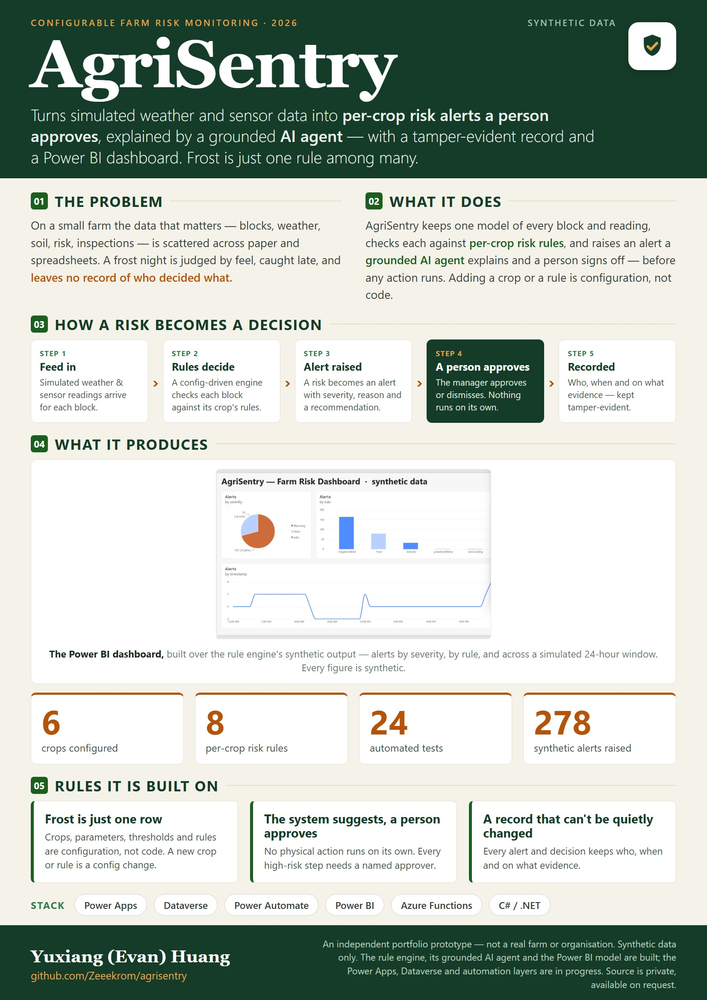
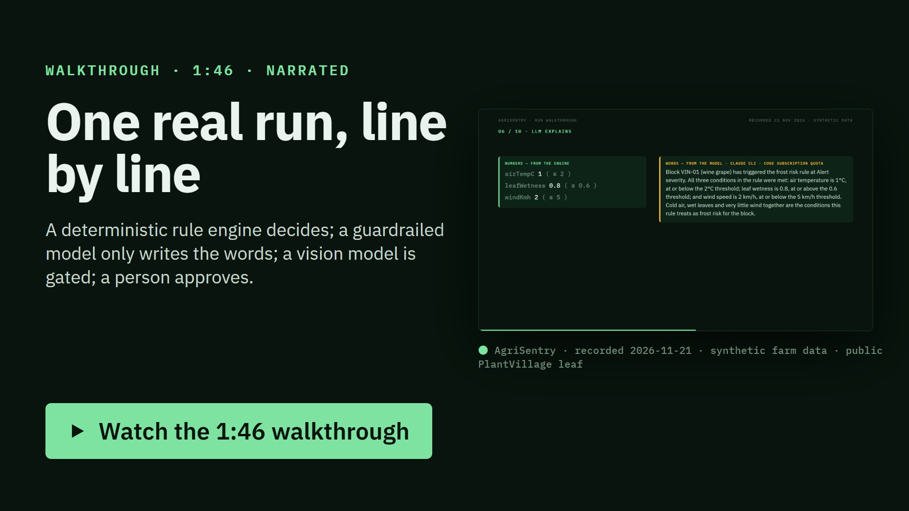
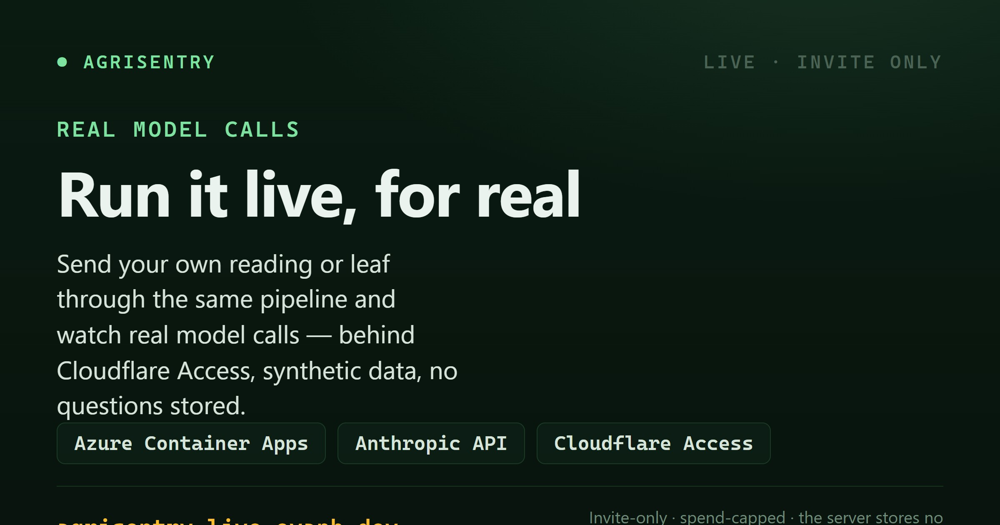
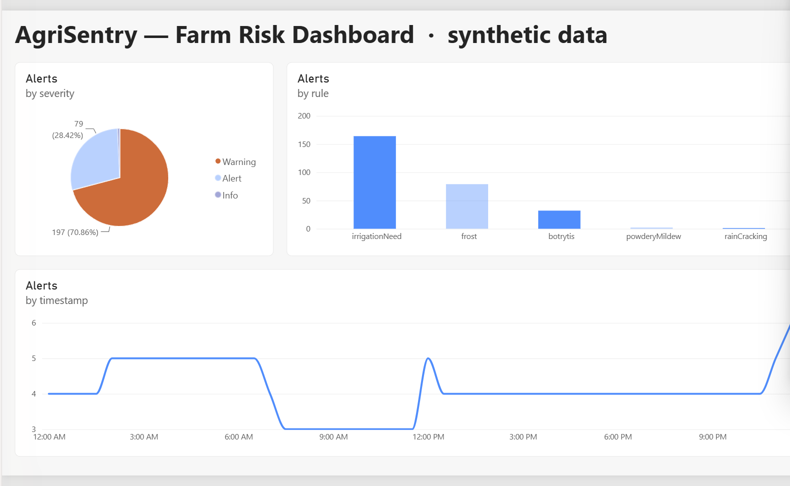

# AgriSentry

 

Farm monitoring on the Microsoft Power Platform: rules decide, AI explains, a person approves.

<table>
<tr>
<td align="center" width="50%"> <b>Concept film</b> · 2:37</td>
<td align="center" width="50%"> <b>Poster</b></td>
</tr>
<tr>
<td align="center" width="50%"> <b>Code walkthrough</b> · 1:46</td>
<td align="center" width="50%"> <b>Live</b> · invite only</td>
</tr>
</table>

Also: [interactive 3D farm view ↗](https://zeeekrom.github.io/agrisentry/3d.html).

**What you can check**

- **Rules decide, the model only explains.** Every number in an alert comes from a deterministic rule engine; the model only writes the words. → [walkthrough](https://zeeekrom.github.io/agrisentry/walkthrough/)
- **Vision proposes, a person decides.** The leaf-vision model suggests a diagnosis over a closed set; low confidence is never auto-diagnosed, and every action needs a person's approval. → [walkthrough](https://zeeekrom.github.io/agrisentry/walkthrough/)
- **It runs on a real model.** Ask the live demo yourself; it calls Claude through the full pipeline. → [live, invite only](https://agrisentry-live.evanh.dev/live/)
- **Every alert is on record.** A Power BI dashboard shows the alerts by severity and by rule across a simulated 24-hour window. → [dashboard](#the-dashboard)

Showcase only: synthetic data, source private. → [Status, source &amp; terms](#status-source--terms)

## The problem

A small farm's operating data — blocks, weather, soil, risks, inspections, actions — lives on paper, in spreadsheets and in people's heads. High-risk events like frost are caught late, judged by feel, and leave no record of who decided what.

Spotting the risk is the easy part. A farm that has to answer for its decisions also needs to know:

- which rule fired, and on what readings;
- what a person should do, in plain words;
- who approved the action, and when;
- that the record can be trusted later;
- and, when AI explains a risk, that it cannot invent a number or act on its own.

AgriSentry makes those controls executable: the rule engine owns the numbers, a constrained AI supplies the words, and a person makes every call — across a farm's own crops and thresholds, without a rebuild.

## Who it is for

| Role | What AgriSentry shows them |
|---|---|
| Farm / operations manager | A per-block status (OK / watch / alert) and, for each alert, the rule, the readings and a plain-language recommendation |
| Field worker | A readable explanation and a suggested action — approved by a person before anything runs |
| Owner | A tamper-evident record of every alert and decision — who, when and on what evidence |

A reference scenario; no real farm, farmer or organisation took part.

## One alert, start to finish

1. **A reading arrives.** Simulated weather and sensor values for a block — temperature, leaf wetness, wind, soil moisture. Every reading is synthetic.
2. **The engine decides.** A configuration-driven rule engine returns which rule fired, the thresholds crossed with the actual values, a severity, and whether a person must approve. All numbers come from here.
3. **The AI explains.** It turns the alert into a plain-language reason and a recommended action, grounded in the engine's facts.
4. **A person is notified** — with the block, the evidence readings, the recommendation and the explanation, and approve / reject.
5. **A person decides.** No physical action (a frost pump, a spray) runs on its own; a high-risk step needs a named approver.
6. **It is recorded** — appended to a tamper-evident audit trail and surfaced on a Power BI dashboard.

Frost on a vineyard is only the lead example; adding a crop or a rule is a configuration change, not a code change.

## How it is kept honest

- **Numbers from code, words from the model.** Every figure in an alert comes from the deterministic engine; the model only phrases it. Run on a live model, all 278 synthetic alerts held this — any number the model can't source is replaced by a deterministic template.
- **The model proposes; a person decides.** Leaf vision suggests a disease over a closed set (it cannot invent one); low confidence is never auto-diagnosed; a person confirms every candidate.
- **It suggests, it never acts.** Opening a pump or spraying is physical and needs a named approver, and every alert and decision is appended to a tamper-evident trail.
- **Automation is bounded.** A change reaches the live demo only after its automated tests pass, and everything running in the cloud is rebuilt from code; the running demo is logged and monitored.
- **Closed by default.** The live demo answers only invited addresses, and the model key lives in a managed vault as its single source — read under a managed identity, never kept in the repo or the pipeline. The model is given no tool that can act: it only returns text, which the rule engine and a person then check.

## The dashboard

## What it can and can't do today

- **Working now** — the rule engine (6 crops, 8 risk rules), the grounded AI explainer and the leaf-vision gate (both run on a live model), a Power BI dashboard, and the invite-only live demo; with 43 automated tests and CI.
- **Designed, not yet live** — the low-code Power Platform layer (Dataverse, Power Apps, Power Automate) is built as a design and is data-ready, awaiting an environment.
- **Not production** — the thresholds are illustrative and would need agronomy calibration; it is single-tenant, and a portfolio prototype, not validated with a farm.

## Want the details?

The source, a live code tour on a call, the architecture and interfaces, the decision records, the tests and the model prompts aren't published here — like the live demo, they're available on request. [Message me on LinkedIn](https://www.linkedin.com/in/evan-h-165976301/) or email [yuxianghuang2026@gmail.com](mailto:yuxianghuang2026@gmail.com).

## Status, source &amp; terms

In active development — an independent portfolio prototype, **not affiliated with any real farm or organisation**, synthetic data only, and performing no real-world actions. A curated, privacy-safe showcase: the write-up, films, poster and synthetic screenshots only — no source code and no real data.

© 2026 AgriSentry. All rights reserved; see [LICENSE](LICENSE). Without written permission, nothing in this repository may be copied, republished or adapted, and the project's code and design may not be rebuilt, whether by hand, with automated tools or with AI cloning tools. The code may not be reverse engineered except where the law allows, and the content may not be scraped, bulk-downloaded or used to train or evaluate AI models. Uses the law already allows, such as fair dealing for review or news reporting, are not affected. Sharing links is welcome. Third-party open-source components keep their own licences; see [THIRD-PARTY-NOTICES.md](THIRD-PARTY-NOTICES.md). Full terms: [terms &amp; copyright](https://zeeekrom.github.io/agrisentry/terms.html).
