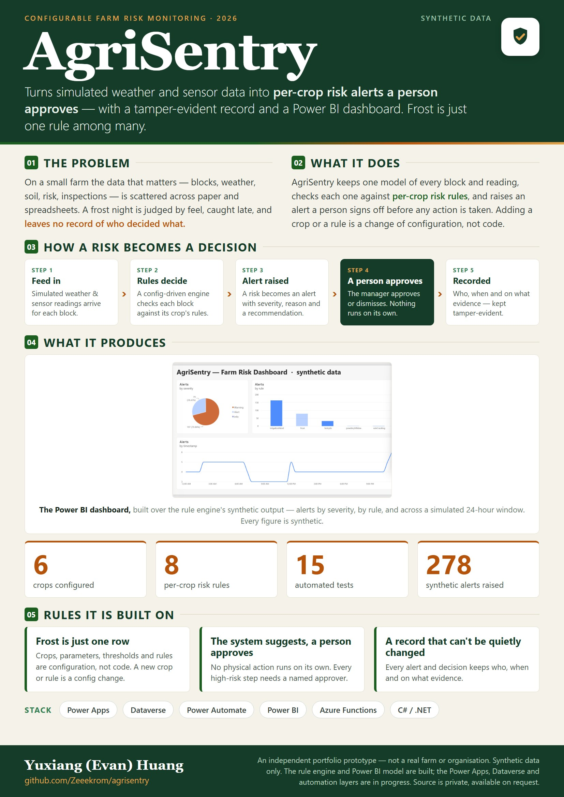
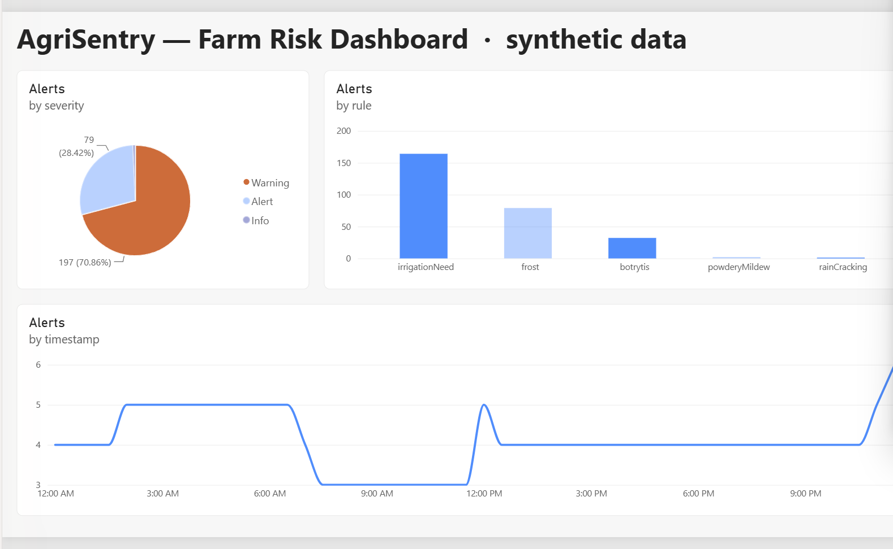
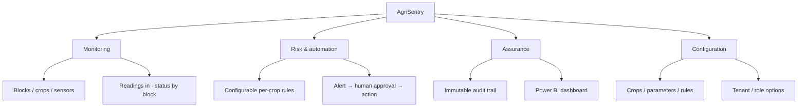
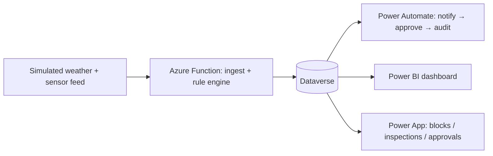

# AgriSentry

 

> A configurable farm-monitoring system on the Microsoft Power Platform. It turns (simulated) weather and sensor data into **per-crop risk alerts that a person approves** before any action, with an immutable audit trail and a Power BI dashboard.

**This is a curated, privacy-safe showcase.** The application source, configuration, solution files and data pipelines live in a private repository. This public edition holds the write-up, high-level diagrams and (as the build progresses) synthetic screenshots only — **no source code and no real data**. Source is available for review on request.

This is an independent portfolio prototype. It is **not affiliated with any real farm or organisation**, uses only synthetic data, and performs no real-world actions.

## Overview

## Dashboard (synthetic data)

*Built in Power BI over the rule engine's synthetic output: alerts by severity, by rule, and across a simulated 24-hour window. Every figure is synthetic.*

## At a glance

| | |
|---|---|
| What it is | A configurable farm-monitoring workflow: per-crop risk rules, human-approved alerts, a tamper-evident record and a dashboard |
| Who it is for | Small / mid farms and the people who run them — managers, field workers, owners |
| The problem | Farm data is scattered across paper and spreadsheets; high-risk events (e.g. frost) are caught late and leave no record of who decided what |
| Approach | One data model, a configuration-driven rule engine, a *system-suggests / human-approves* loop, and tamper-evident records |
| Configurable | Crops, parameters and risk rules are **configuration, not code** — layered as content / tenant / role |
| Stack | Power Apps · Dataverse · Power Automate · Power BI · Azure Functions (.NET/C#) |
| Status | In development; simulated data; source private |

## The system in blocks

## Configurable by design

- **Content** — crops, monitored parameters, risk rules and thresholds are data you extend (frost for vineyards, late blight for potatoes, botrytis for berries, …), not hard-coded.
- **Tenant** — each farm enables its own crops/rules, notification channels and approval strictness: a common core with options, no rebuild per customer.
- **Role** — manager / field worker / owner get tailored views and permissions.

## How a risk alert flows

Each crop maps to one representative flow (e.g. vineyard → frost as the lead example). The rule engine is configuration-driven, so adding a crop or a rule is a config change, not a code change.

## Design principles

- **Numbers from code, words from the model** — risk decisions come from a deterministic rule engine; any AI only writes narrative, and every figure is traceable.
- **System suggests, a person approves** — no automatic physical action; high-risk steps need a named approver.
- **Tamper-evident audit** — every alert and decision is recorded immutably (who, when, on what evidence).
- **Data residency & least exposure** — data kept in-region; model payloads minimised.
- **Tested rule engine, separated from I/O** — the decision logic is unit-tested against gold-standard cases.

## Technology

Microsoft Power Platform (Power Apps · Dataverse · Power Automate · Power BI) · Azure Functions (.NET/C#) · optional 3D block view via a PCF (React/three.js) control · Git.

## Boundaries / what is not finished

- Simulated data only; not connected to real farms, sensors or weather sources.
- Risk thresholds are illustrative and would need agronomy calibration.
- Single-tenant demo; multi-tenant and higher-assurance profiles are designed-for, not built.
- Aquaculture is out of scope by design.
- A portfolio prototype — not production-ready.

## Status & source

In active development. The source, tests and configuration are kept in a private repository and are **available for review on request** (e.g. a walkthrough in an interview).
