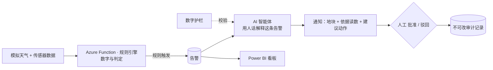

# AgriSentry

[](README.md) [](README.zh-CN.md)

**🌐 在线作品页 → [zeeekrom.github.io/agrisentry](https://zeeekrom.github.io/agrisentry/)** · [交互式 3D 农场 ↗](https://zeeekrom.github.io/agrisentry/3d.html) · [概念片 ↗](https://zeeekrom.github.io/agrisentry/film/)

> 一个建在 Microsoft Power Platform 上的**可配置农场监测系统**,核心是一个**受约束的农场 AI 智能体**。它把(模拟的)天气与传感器数据,转化成**按作物划分、需人工批准的风险告警**——智能体负责盯、负责用人话解释每条告警、负责回答,而每个数字都来自确定性规则引擎,每个决定都由人来拍板;配不可篡改的审计记录和 Power BI 看板。


<a href="https://zeeekrom.github.io/agrisentry/film/"></a>

**概念片:** [看 2:37 的旁白短片](https://zeeekrom.github.io/agrisentry/film/) —— 一个小农场今天缺什么、一个会盯会讲会认病会答的农场 AI、以及始终由人拍板的那个人。英文旁白(合成配音)配字幕;合成数据。

**这是一个精选、脱敏的作品展示。** 应用源码、配置、解决方案文件与数据管道都放在私有仓库。这个公开版只包含说明文字、高层架构图与合成数据截图——**不含源码、不含真实数据**。源码可应要求提供审阅。

这是一个独立的作品原型。它**与任何真实农场或机构无关**,仅使用合成数据,不执行任何真实世界的动作。

## 目录

- [速览](#速览)
- [问题所在](#问题所在)
- [给谁用](#给谁用)
- [一条告警，从头到尾](#一条告警从头到尾)
- [AI 智能体](#ai-智能体)
- [设计原则](#设计原则)
- [按设计可配置](#按设计可配置)
- [看板](#看板)
- [怎么建起来的](#怎么建起来的)
- [技术](#技术)
- [合成数据](#合成数据)
- [哪些还没做](#哪些还没做)
- [这个项目证明了什么](#这个项目证明了什么)
- [状态、源码与条款](#状态源码与条款)

## 概览


## 速览

| | |
|---|---|
| 是什么 | 一套可配置的农场监测流程：按作物的风险规则、一个 grounded 的 AI 智能体、需人工批准的告警、防篡改的记录，以及一个看板 |
| 给谁用 | 中小型农场和经营它们的人——经理、田间工人、农场主 |
| 解决什么 | 农场数据散落在纸质与表格里；高风险事件（如霜冻）发现得晚，且留不下"谁做了什么决定"的记录 |
| 做法 | 一套数据模型、一个配置驱动的规则引擎、一个*系统建议 / 人工批准*的闭环，以及防篡改记录 |
| AI 智能体 | 会盯、会讲、会答——grounding 在引擎的事实上、由人批准；它从不自己动手 |
| 技术栈 | Power Apps · Dataverse · Power Automate · Power BI · Azure Functions (.NET/C#) · Anthropic / Azure OpenAI |
| 证据 | 24 个自动化测试（规则引擎 + 智能体的 grounding）、模拟 24 小时窗口内的 278 条合成告警、带文解释器已在真实大模型上跑过、文本化 Power BI 工程、GitHub Actions CI——源码私有 |
| 数据 | 仅合成——无真实农场、传感器、天气或个人数据 |
| 状态 | 开发中。作品原型；未经农场验证、非生产就绪 |

## 问题所在

一个小农场的运营数据——地块、天气、土壤、风险、巡检、处置——散在纸、表格和人脑里。霜冻这类高风险事件发现得晚、凭经验判断、还留不下记录。给一条读数分类是最容易的部分;一个要对自己决定负责的农场,还得答得上来:

- **是哪条规则触发的、依据哪些读数?** 不只是"有霜冻风险",而是具体被突破的那几个阈值。
- **该让人做什么,用人话说?** 看板上一个数字不是一个决定。
- **谁批准了这个动作、什么时候?** 开防霜泵、喷药都是有成本的物理动作。
- **这条记录日后信得过吗?** 有没有人能悄悄改掉当初的决定?
- **AI 解释风险时,会不会编个数字、或自作主张?** 还是被死死按在事实和人工批准上?
- **同一套系统能不能服务另一个农场** 而不用重做——换种作物、换个阈值?

AgriSentry 把这些控制变成可执行的:规则引擎管数字,一个受约束的 AI 智能体负责措辞,人来拍每一个板。

## 给谁用

| 角色 | 他们需要被回答的问题 | AgriSentry 给他们什么 |
|---|---|---|
| 农场 / 运营经理 | 哪些地块没事、哪些现在需要我? | 每块地的状态（正常 / 注意 / 告警）;每条告警都附规则、依据读数和一句人话建议 |
| 田间工人 | 这事我该怎么办、是我来定吗? | 一段看得懂的解释 + 建议动作——执行前都要人批准;巡检在田里一次录入 |
| 农场主 | 系统做的决定我信得过吗? | 每条告警与决定的不可改记录——谁、何时、依据什么证据 |
| 农艺师 / IT | AI 被按在事实上了吗、规则能不能不重做就改? | 每条 AI 叙述都过数字护栏;作物 / 参数 / 阈值 / 规则都是配置,不是代码 |

以上角色是一个参考场景。没有任何真实农场、农户或机构参与。

## 一条告警，从头到尾



1. **一条读数进来。** 某地块的模拟天气与传感器值——气温、叶面湿度、风速、土壤湿度、降雨。每条读数都是合成的。
2. **引擎判定。** 配置驱动的规则引擎按该作物启用的规则逐条评估,返回:哪条规则触发、被突破的阈值连同实际值、严重度、以及是否需人工批准。所有数字都来自这里。
3. **智能体解释。** AI 智能体把告警转成一句人话原因 + 建议动作——grounding 在引擎的事实上。一道护栏会挡下任何"源数据之外的数字",或任何暗示系统自作主张的措辞。
4. **通知到人。** 通知带着地块、依据读数、建议和解释,配批准 / 驳回。
5. **人来决定。** 任何物理动作(开防霜泵、喷药)都不会自己运行;高风险步骤需要一个具名的批准人。
6. **留痕。** 每条告警与决定都追加进防篡改审计记录——谁、何时、依据什么——并呈现在 Power BI 看板上。

葡萄园的霜冻只是主打示例。引擎是配置驱动的,所以加一种作物或一条规则是改配置,不是改代码。

## AI 智能体

AgriSentry 的 AI 是一个**受约束的农场智能体**:聪明到能帮上忙,又被管得够紧、让真实运营敢用。它做四件事,唯独不做第五件:

- **会盯** —— 规则引擎持续跑在天气与传感器数据上,把要紧的告警挑出来(霜冻、晚疫、灰霉、土壤缺水……)。
- **会讲** —— 每条告警,智能体写出*为什么触发*和*该考虑什么*,用人话。**已做实,并在真实大模型上跑过。**
- **会看** *(设计中)* —— 田间工人拍一张叶片照,图像模型给出候选病害与置信度,把握不准时转人工。
- **会答** *(设计中)* —— "今天哪些地块要关注?"这类问题,grounding 在农场自己的数据上。
- **它不动手。** 开防霜泵、喷药都是物理动作;智能体只建议,由具名的人批准。

**数字来自代码,文字来自模型。** 解释里的数字只来自确定性引擎,模型只负责措辞。一道护栏让这条变成可执行的约束——它会挡下任何含"源数据之外数字"的叙述、或任何暗示自主动作的措辞,并回退到确定性模板。278 条合成告警全部通过。

*确定性模板——离线、永远可用的兜底:*

```
Block VIN-01 (Wine grape): the 'Frost risk' rule fired because
airTempC is 1 (≤ 2); leafWetness is 0.8 (≥ 0.6); windKmh is 2 (≤ 5).
→ Consider frost protection for this block. A person must approve before any action is taken.
```

*同一条告警，由真实大模型叙述——走 Code 订阅额度，一次真跑存档（模型措辞每次不同；图中每个数字都是合成的）：*

```
$ dotnet run --project src/AgriSentry.Narrate

▇ VIN-01 (grape) · frost · Alert
  facts : airTempC=1 (≤2); leafWetness=0.8 (≥0.6); windKmh=2 (≤5)
  model : Block VIN-01 (wine grape) has triggered a Frost risk alert. All
          three conditions in the rule are met: air temperature is 1°C, at
          or below the 2°C threshold; leaf wetness is 0.8, at or above the
          0.6 threshold; and wind speed is 2 km/h, at or below the 5 km/h
          threshold. Low temperature, wet leaves and calm air together
          match the conditions this rule watches for frost.
  guard : PASS — kept the model's words.

3 alerts: 3 kept the model's words, 0 fell back to the template.
Numbers came from the engine throughout; the guardrail enforced it on a live model.
```

叙述默认由确定性模板生成——离线、永远可用——而**同一条管道也已在真实大模型上跑过**:在真模型上,数字依旧全部来自引擎,护栏照常生效,被挡下的就回退到模板。护城河不是"接了个 AI",而是外面那层 grounding、护栏、人工批准与审计。

## 设计原则

- **数字来自代码,文字来自模型** —— 风险决策和每个数字都来自确定性规则引擎;AI 只写叙述,护栏把它按在事实上。
- **引擎决定,智能体解释** —— 智能体读告警和获批的数据;它不跑规则、不做人的决定、不动手。
- **系统建议,由人批准** —— 不自动执行任何物理动作;高风险步骤需要一个具名的批准人。
- **不可改审计** —— 每条告警和决定都被不可篡改地记录(谁、何时、依据什么证据)。
- **配置,而非代码** —— 加一种作物、一个阈值或一条规则是改数据,不是改引擎。
- **经过测试、与 I/O 分离** —— 决策逻辑与 AI 的 grounding 都针对黄金标准用例做了单元测试。

## 按设计可配置

- **内容** —— 作物、监测参数、风险规则与阈值都是你可以扩展的数据(葡萄园的霜冻、马铃薯的晚疫病、浆果的灰霉病……),不是写死的代码。
- **租户** —— 每个农场启用自己的作物/规则、通知渠道和批准严格度:一个共同内核加选项,不用为每个客户重做。
- **角色** —— 经理 / 田间工人 / 农场主 各有量身定制的视图与权限。

## 看板


*用 Power BI 基于规则引擎的合成输出搭建：按严重度、按规则、以及跨模拟 24 小时窗口的告警。每个数字都是合成的。*

## 怎么建起来的

先有引擎和它的控制,AI 建在它们之上、被 grounding 和护栏管住;低代码的 Power Platform 层已设计好、就等部署。

| 部分 | 状态 |
|---|---|
| 配置驱动规则引擎（C#/.NET —— 6 作物、8 风险规则、6 参数） | **已建** · 15 个单测 |
| grounded AI 带文解释器（确定性模板 + 数字护栏 + 可切换 LLM） | **已建** · 9 个测试 · 已在真实大模型上跑过,278/278 条合成告警 grounded |
| Power BI 看板（文本化 PBIP,合成数据） | **已建** |
| 展示层：作品主页、3D 农场视图、概念片、GitHub Actions CI、版权 + 条款 | **已建** |
| Dataverse 数据模型（表、选项集、关系、种子 + 导入数据） | **设计中** · 就等部署（缺一个可用环境） |
| Power Apps（地块总览 / 巡检录入 / 告警确认） | **设计中** |
| Power Automate（通知 → 批准 → 不可改审计） | **设计中** |
| 叶片拍照病害识别、对话式 copilot | **设计中** |

## 技术

- Microsoft Power Platform —— Power Apps · Dataverse · Power Automate · Power BI
- Azure Functions (.NET / C#),作为数据流、规则引擎与 Dataverse 之间的衔接层
- 一个 C# 的配置驱动规则引擎,配 xUnit 测试与 GitHub Actions CI
- 一个 grounded 的 AI 带文解释器,藏在 provider 无关的接口后面（Anthropic / Azure OpenAI),带确定性模板兜底
- 可选的 3D 地块视图,通过 PCF（React / three.js）控件;公开 demo 用浏览器内的 three.js
- Git

## 合成数据

一切都是合成的。天气与传感器数据、读数、告警、农场、地块、作物全是虚构的——没有真实农场、没有真实传感器、没有真实天气源、没有个人数据。那些数字(模拟 24 小时窗口、6 个地块、278 条合成告警、1,728 条读数)是用来跑通引擎和看板的,它们不代表任何真实农场的表现。

## 哪些还没做

- **live Power Platform 暂缓。** 规则引擎、AI 带文解释器、看板都已建;Dataverse / Power Apps / Power Automate 这层已设计好、数据也备齐,但还没部署到 live 环境。solution 与种子数据都存在 Git 里,拿到环境几分钟即可部署。
- 智能体的*会看*(叶片识别)与*会答*(copilot)是设计中,未建。
- 风险阈值仅为示意,实际需要农艺校准。
- 单租户演示;多租户与更高保证档是"已按此设计",但尚未构建。
- 水产养殖按设计不在范围内。
- 一个作品原型 —— 非生产就绪。

真要让一个真实农场用上这类系统,还需要:经过认证的身份与角色、一个持久且独立受保护的审计库、连到它自己系统的连接器,以及经农艺校准的策略来替换演示阈值。这些都还没建。

## 这个项目证明了什么

- 把决定和数字放进一个确定性引擎、放在模型之外,无论日后换哪个模型,结果都保持可解释。
- 一道护栏把"数字来自代码、文字来自模型"从口号变成可执行的校验——在真模型上验证过。
- 一个受约束、人工批准的 AI,才是真实运营敢用的那版;难的是模型外面那层工程,不是那次模型调用。
- 把作物、参数和规则都当配置,让一套系统不重做就能服务另一个农场。
- 给每个数字都标上"合成",能避免一个演示用的数据被当成真实表现来读。

## 状态、源码与条款

正在积极开发中。源码、测试与配置保存在私有仓库,**可应要求提供审阅**(例如在面试中做一次讲解)。

© 2026 AgriSentry，保留所有权利，见 [LICENSE](LICENSE)。未经书面许可，不得复制、转载或改编本仓库的任何内容，也不得用手工、自动化工具或 AI 克隆工具重建项目的代码和设计；除法律允许的情形外，不得对代码进行逆向工程；不得抓取、批量下载这些内容，或把它们用于训练、评测 AI 模型。法律本身允许的使用（如为评论、新闻报道合理引用）不受影响。欢迎分享链接。第三方开源组件保留各自的许可，见 [THIRD-PARTY-NOTICES.md](THIRD-PARTY-NOTICES.md)。完整条款见[条款与版权](https://zeeekrom.github.io/agrisentry/terms.html)页。
