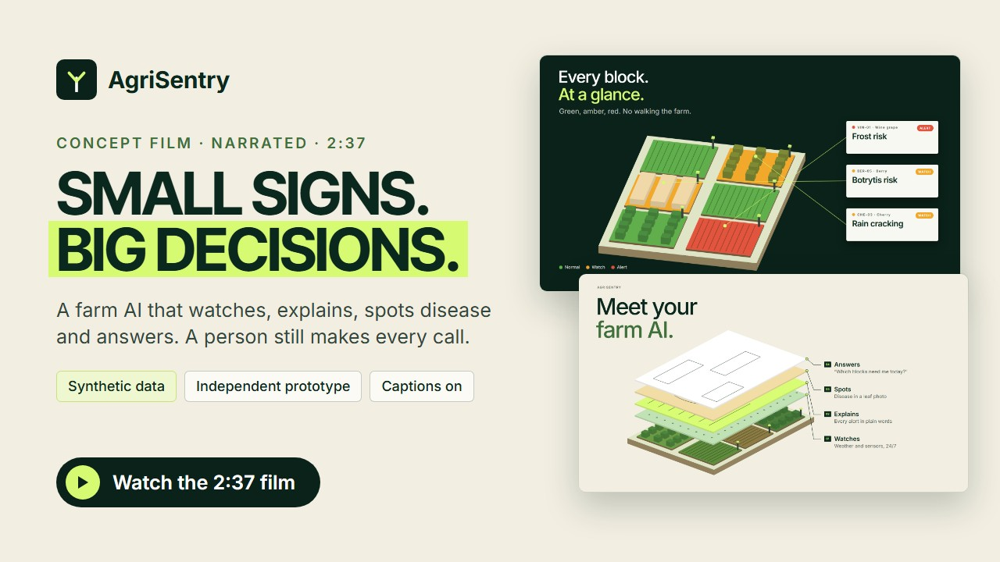
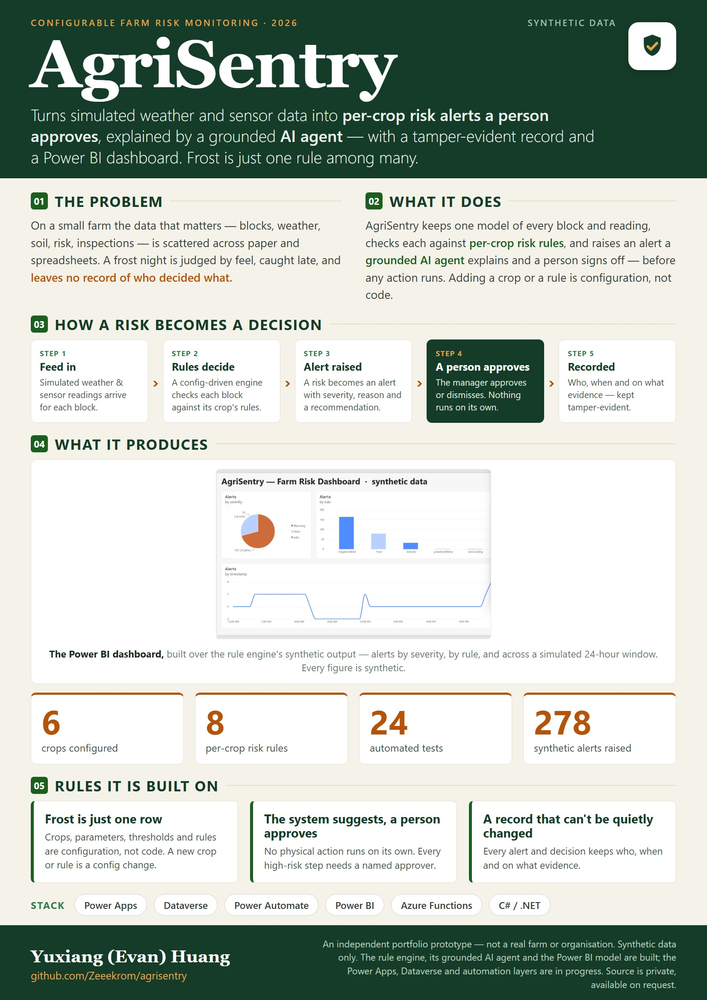
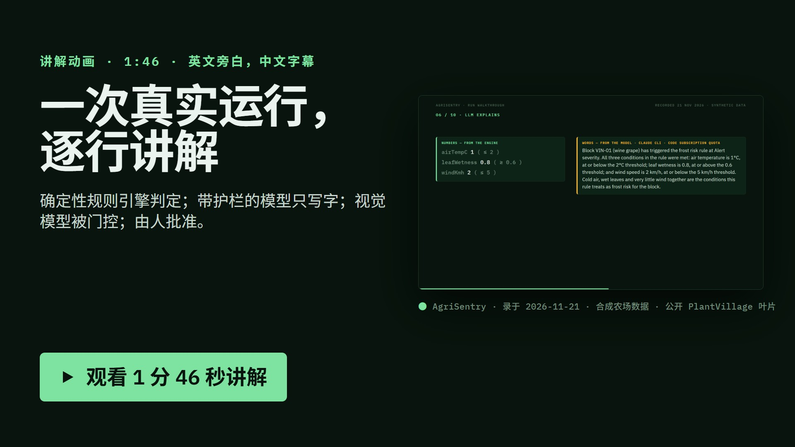
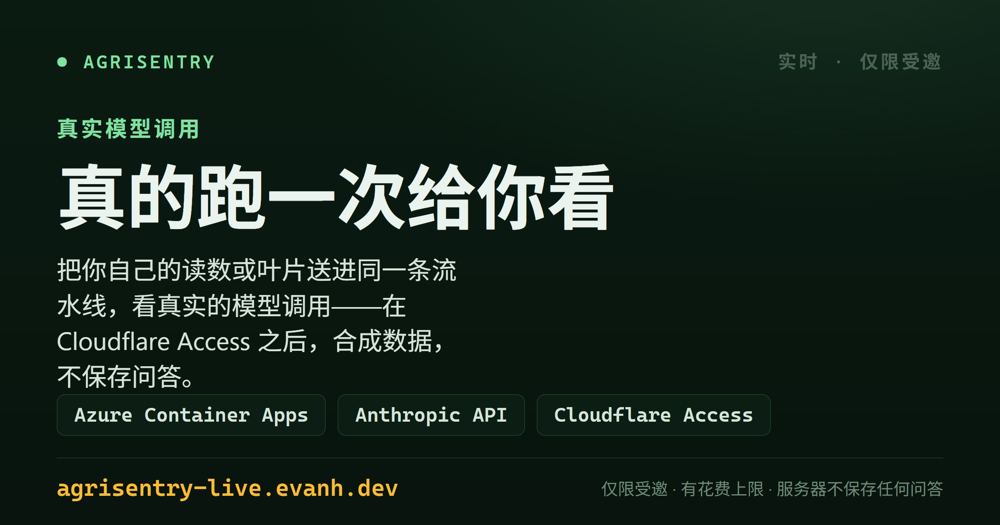
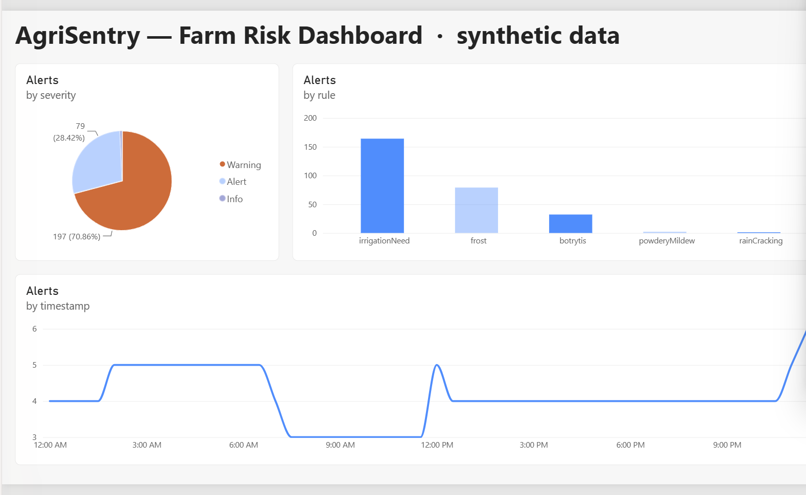

# AgriSentry

 

建在 Microsoft Power Platform 上的农场监测：规则判定，AI 讲解，人来批准。

<table>
<tr>
<td align="center" width="50%"> <b>概念片</b> · 2:37</td>
<td align="center" width="50%"> <b>海报</b></td>
</tr>
<tr>
<td align="center" width="50%"> <b>代码讲解</b> · 1:46</td>
<td align="center" width="50%"> <b>实时版</b> · 只给受邀邮箱</td>
</tr>
</table>

另有：[交互式 3D 农场 ↗](https://zeeekrom.github.io/agrisentry/3d.html)。

**能看到什么**

- **规则判定，模型只负责说话。** 告警里的每个数字都来自确定性的规则引擎，模型只写文字。→ [讲解动画](https://zeeekrom.github.io/agrisentry/walkthrough/)
- **视觉模型只提建议，人来定。** 叶片识别在一个封闭集合里给出诊断建议，置信度低的不会自动下结论，每个动作都要人批准。→ [讲解动画](https://zeeekrom.github.io/agrisentry/walkthrough/)
- **真的调模型。** 实时版可以自己提问，后面经整条管线调的是 Claude。→ [实时版（只给受邀邮箱）](https://agrisentry-live.evanh.dev/live/)
- **每条告警都有记录。** Power BI 看板按严重度、按规则展示模拟 24 小时内的告警。→ [看板](#看板)

展示版：合成数据，源码不公开。→ [状态、源码与条款](#状态源码与条款)

## 问题所在

一个小农场的运营数据——地块、天气、土壤、风险、巡检、动作——散落在纸上、表格里和人的脑子里。霜冻这类高风险事件发现得晚、凭感觉判断、还留不下谁做了什么决定的记录。

发现风险是简单的。一个要为自己的决定负责的农场，还得知道：

- 哪条规则被触发、依据哪些读数；
- 人该怎么做，用人话说；
- 谁在什么时候批准了动作；
- 这条记录事后信得过；
- 以及 AI 讲解风险时，不能凭空编数字，也不能自己动手。

AgriSentry 把这些把关做成可执行的：规则引擎掌管数字，一个受约束的 AI 负责文字，每个决定由人拍板——而且换一个农场自己的作物和阈值，不用重做。

## 给谁用

| 角色 | AgriSentry 给他看什么 |
|---|---|
| 农场 / 运营经理 | 每个地块的状态（正常 / 关注 / 告警），每条告警附规则、读数和一句人话建议 |
| 田间工人 | 一段读得懂的解释和一个建议动作——动手前由人批准 |
| 农场主 | 每条告警和决定的不可篡改记录——谁、何时、依据什么 |

这是一个参考场景；没有任何真实农场、农户或机构参与。

## 一条告警，从头到尾

1. **来了一条读数。** 某地块的模拟天气和传感器值——温度、叶面湿度、风、土壤湿度。每条都是合成的。
2. **引擎做判断。** 配置驱动的规则引擎返回：哪条规则被触发、越过的阈值和实际值、严重度、要不要人批准。所有数字都从这儿来。
3. **AI 来解释。** 把告警变成一句人话的原因和一个建议动作，依据引擎的事实。
4. **通知到人**——附地块、证据读数、建议和解释，带批准 / 驳回。
5. **人来拍板。** 任何物理动作（防霜泵、打药）都不会自己执行；高风险的那步要一个具名批准人。
6. **记录下来**——写进不可篡改的审计链，并呈现在 Power BI 看板上。

葡萄园霜冻只是领头的例子；加一个作物或一条规则是改配置，不是改代码。

## 怎么保证靠谱

- **数字来自代码，文字来自模型。** 告警里的每个数字都来自确定性引擎，模型只负责措辞。在真模型上，278 条合成告警全都守住了这条——模型给不出来源的数字会被确定性模板替掉。
- **模型只提建议，人来定。** 叶片识别在封闭集合里给病害建议（造不出集合外的病名）；置信度低的不自动下结论；每个候选都由人确认。
- **只建议、从不动手。** 开泵或打药是物理动作、要具名批准人；每条告警和决定都不可篡改地记录下来。

## 看板

## 现在能做、还不能做什么

- **已经能用**——规则引擎（6 作物、8 条风险规则）、只依据引擎事实的 AI 解释器和叶片视觉门控（两样都在真模型上跑过）、一个 Power BI 看板、以及受邀才能用的实时版；配 43 个自动测试和 CI。
- **设计好了、还没上线**——低代码 Power Platform 层（Dataverse、Power Apps、Power Automate）已做成设计、数据也备好，就等一个环境。
- **非生产**——阈值是示意性的、要经农艺校准；单租户、作品原型，未经真实农场验证。

## 想看更多？

源码、通话里的代码导览、架构与接口、决策记录、测试和模型提示词都不在这里公开——和实时版一样，可约看。[领英私信我](https://www.linkedin.com/in/evan-h-165976301/)，或发邮件到 [yuxianghuang2026@gmail.com](mailto:yuxianghuang2026@gmail.com)。

## 状态、源码与条款

正在积极开发中——一个独立的作品原型，**与任何真实农场或机构无关**，仅使用合成数据，不执行任何真实世界的动作。这是一个精选、脱敏的展示：只含说明文字、影片、海报和合成截图——不含源码、不含真实数据。

© 2026 AgriSentry，保留所有权利，见 [LICENSE](LICENSE)。未经书面许可，不得复制、转载或改编本仓库的任何内容，也不得用手工、自动化工具或 AI 克隆工具重建项目的代码和设计；除法律允许的情形外，不得对代码进行逆向工程；不得抓取、批量下载这些内容，或把它们用于训练、评测 AI 模型。法律本身允许的使用（如为评论、新闻报道合理引用）不受影响。欢迎分享链接。第三方开源组件保留各自的许可，见 [THIRD-PARTY-NOTICES.md](THIRD-PARTY-NOTICES.md)。完整条款见[条款与版权](https://zeeekrom.github.io/agrisentry/terms.html)页。
