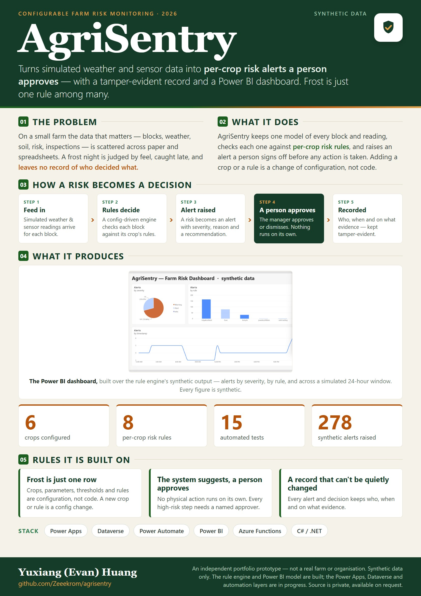
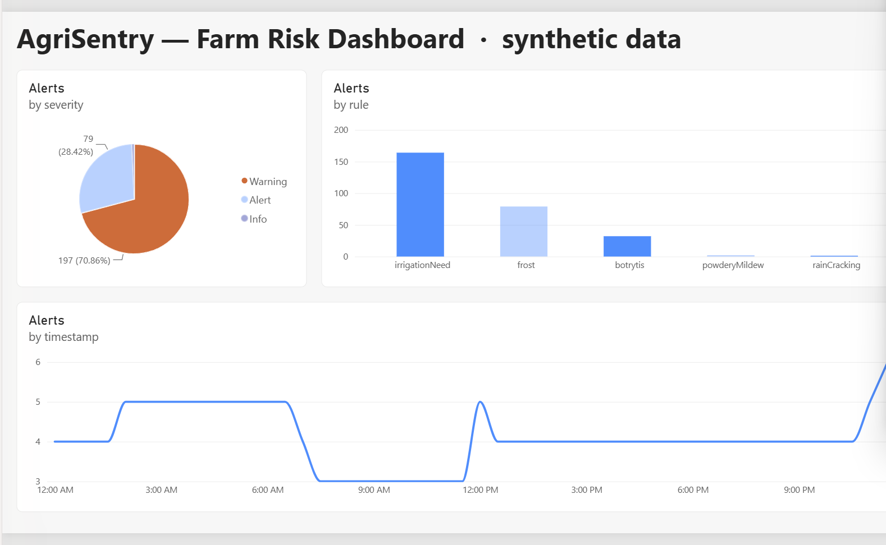
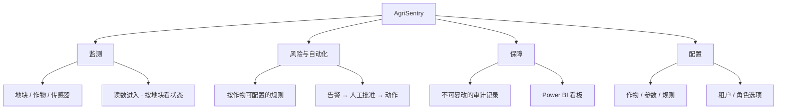
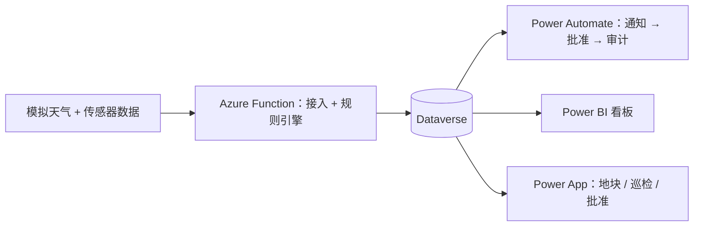

# AgriSentry

 

> 一个建在 Microsoft Power Platform 上的**可配置农场监测系统**。它把（模拟的）天气与传感器数据，转化成**按作物划分、需人工批准的风险告警**，任何动作执行前都要人确认；配有不可篡改的审计记录和 Power BI 看板。

**这是一个精选、脱敏的作品展示。** 应用源码、配置、解决方案文件与数据管道都放在私有仓库。这个公开版只包含说明文字、高层架构图，以及（随开发推进的）合成数据截图——**不含源码、不含真实数据**。源码可应要求提供审阅。

这是一个独立的作品原型。它**与任何真实农场或机构无关**，仅使用合成数据，不执行任何真实世界的动作。

## 概览

## 看板（合成数据）

*用 Power BI 基于规则引擎的合成输出搭建：按严重度、按规则、以及跨模拟 24 小时窗口的告警。每个数字都是合成的。*

## 速览

| | |
|---|---|
| 是什么 | 一套可配置的农场监测流程：按作物的风险规则、需人工批准的告警、防篡改的记录，以及一个看板 |
| 给谁用 | 中小型农场和经营它们的人——经理、田间工人、农场主 |
| 解决什么 | 农场数据散落在纸质与表格里；高风险事件（如霜冻）发现得晚，且留不下"谁做了什么决定"的记录 |
| 做法 | 一套数据模型、一个配置驱动的规则引擎、一个*系统建议 / 人工批准*的闭环，以及防篡改记录 |
| 可配置 | 作物、参数和风险规则都是**配置，而非代码**——按 内容 / 租户 / 角色 分层 |
| 技术栈 | Power Apps · Dataverse · Power Automate · Power BI · Azure Functions (.NET/C#) |
| 状态 | 开发中；合成数据；源码私有 |

## 系统结构

## 按设计可配置

- **内容** —— 作物、监测参数、风险规则与阈值都是你可以扩展的数据（葡萄园的霜冻、马铃薯的晚疫病、浆果的灰霉病……），不是写死的代码。
- **租户** —— 每个农场启用自己的作物/规则、通知渠道和批准严格度：一个共同内核加选项，不用为每个客户重做。
- **角色** —— 经理 / 田间工人 / 农场主 各有量身定制的视图与权限。

## 风险告警如何流转

每种作物对应一个代表性流程（如 葡萄园 → 以霜冻为主要示例）。规则引擎是配置驱动的，所以增加一种作物或一条规则是改配置，而不是改代码。

## 设计原则

- **数字来自代码，文字来自模型** —— 风险决策来自一个确定性的规则引擎；任何 AI 只负责写叙述性文字，每个数字都可追溯。
- **系统建议，由人批准** —— 不自动执行任何物理动作；高风险步骤需要一个具名的批准人。
- **防篡改审计** —— 每条告警和决定都被不可篡改地记录（谁、何时、依据什么证据）。
- **数据驻留与最小暴露** —— 数据保留在本区域；发给模型的载荷最小化。
- **规则引擎经过测试，且与 I/O 分离** —— 决策逻辑针对黄金标准用例做了单元测试。

## 技术

Microsoft Power Platform (Power Apps · Dataverse · Power Automate · Power BI) · Azure Functions (.NET/C#) · 可选的 3D 地块视图（基于 PCF 的 React/three.js 控件） · Git。

## 边界 / 哪些还没做

- 仅合成数据；未接入真实农场、传感器或天气源。
- 风险阈值仅为示意，实际需要农艺校准。
- 单租户演示；多租户与更高保障等级是"已按此设计"，但尚未构建。
- 水产养殖按设计不在范围内。
- 一个作品原型 —— 非生产就绪。

## 状态与源码

正在积极开发中。源码、测试与配置保存在私有仓库，**可应要求提供审阅**（例如在面试中做一次讲解）。
